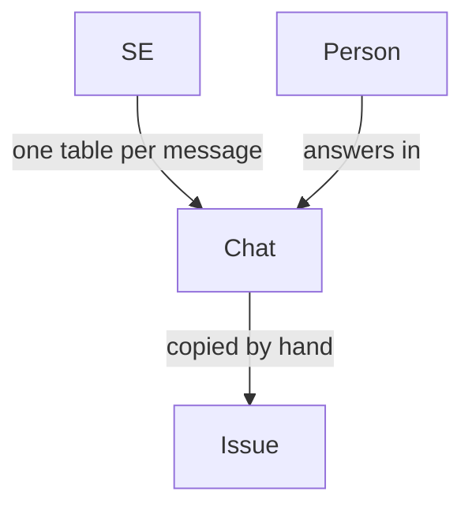

# How decisions reach the person

## Current situation

This is one case of how any decision reaches the person, so it decides the mechanism for every
decision, not for one. Today SE shows each decision as one option table in a chat message, one
decision per turn, and the person answers in the chat.



## The problem

A chat table dies with the session that showed it: answers had to be copied into issues by hand.
And the person wants one page per decision, in their words: "fundamentally, one decision in the
end should be a one-pager".

## What others do

- **Architecture decision records** (ADRs, after Michael Nygard): one short Markdown file per
  decision with its context, the decision and a status. For example, a repository holds
  `docs/adr/0005-use-postgres.md`, whose status line reads `Accepted`.
- **RFC processes**: one document per proposal, discussed in its own thread and accepted by a
  named team. For example, Python's PEP 8 was proposed, discussed and accepted as one document.
- **Required reviews**: the approver answers on the change itself, one change at a time. For
  example, a GitHub pull request reads "Review required" until a code owner approves it.

```pugh
context: a person who blesses SE's decisions
concern: how a decision reaches the person and is kept
criteria:
  - {key: record, label: The record survives the session, weight: 3, better: higher, kind: judged}
  - {key: effort, label: The person's effort per decision, weight: 3, better: higher, kind: judged}
  - {key: volume, label: Many decisions without a flood, weight: 2, better: higher, kind: judged}
datum: {prefer: [chat]}
candidates:
  - key: deck
    label: Decision deck
    short: Deck
    what: Each decision is one note rendered as a one-pager; the notes go to the person as one deck, answered in one pass.
    marks:
      record: {mark: 1, because: the answered artifact is a file that outlives the session}
      effort: {mark: 1, because: one page per decision answered with one key}
      volume: {mark: 1, because: every open decision comes in one deck and one pass}
    wins: The answered artifact is the record and outlives the session; the person sees every open decision at once.
    losses: Each deck is built and handed over with the deck command; the person needs a browser or the Claude app.
    success: Every decision the person blesses has its answered artifact, and none is copied from a chat by hand.
  - key: chat
    label: Tables in the chat (keep what we have)
    short: Chat
    what: SE shows one option table per message, numbered against the open total.
    marks: {record: 0, effort: 0, volume: 0}
    wins: Works today with nothing to build.
    losses: The answer lives in the chat until someone copies it; one decision per turn.
    success: Every answer given in the chat reaches the issue it decides.
  - key: issue
    label: An issue per decision
    short: Issues
    what: Each decision is a GitHub issue minted for the person, answered in a comment.
    marks:
      record: {mark: 1, because: the question and its answer stay on GitHub}
      effort: {mark: -1, because: the person reads an issue thread instead of one page}
      volume: {mark: -1, because: each decision is one more issue in the work queue}
    wins: The question and its answer are on GitHub from the start.
    losses: The person reads issue threads instead of one page; questions crowd the work queue.
    success: Every decision issue is answered in its own thread, and the work queue holds no question.
checklist:
  - item: Class or case
    answer: A case of how any decision reaches the person; decided for every decision.
    pass: true
  - item: Is the problem real
    answer: The person's words ("one decision in the end should be a one-pager") and chat answers that had to be copied into issues by hand; decision records, RFC processes and required reviews each answer one decision at a time, so the problem is a known one.
    pass: true
  - item: Keep what we have
    answer: B is what we have, so it is the datum, and every option is marked against it, never against one not yet built.
    pass: true
  - item: A named loser
    answer: B loses on the record and on one decision per turn; C loses on the person's effort and on crowding the work queue.
    pass: true
  - item: Fair criteria
    answer: Each criterion names its benefit; the record counts once (survival), and volume is not the person's effort per decision; weights were set before the marks.
    pass: true
  - item: Right before cheap
    answer: No criterion weighs the cost to build A, the deck command and its answers bundle, since that effort is ordinary work and not exceptional; A wins on the record, the person's effort and volume.
    pass: true
  - item: What if
    answer: B wins only in a world where a deck cannot reach the person at all; the tripwire is a deck the person could not open and the fallback is B. C beats A only where the person's effort and volume count for less than nothing, so C has no world of its own.
    pass: true
  - item: Undo cost
    answer: Easy to reverse; the notes are Markdown and the chat stays available.
    pass: true
  - item: Consistency
    answer: C contradicts "issues are used as a transport between boxes"; it would need issues to carry questions as well as work. A replaces the rule of one table per message.
    pass: false
    options: [C]
```
